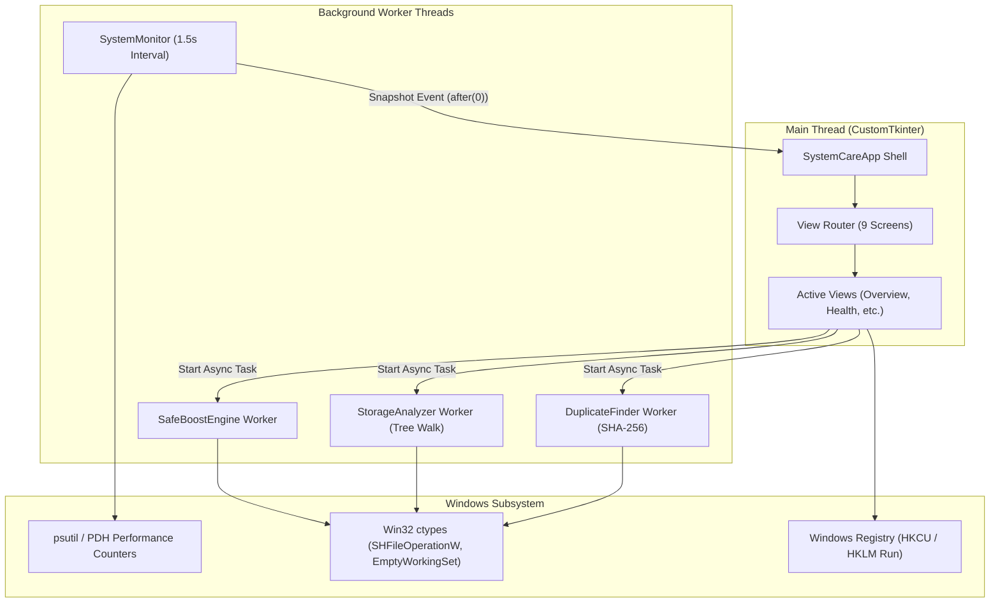

# SystemCare Architecture & Technical Specification

## Overview

**SystemCare — PC Health & Performance Optimizer** is a lightweight, local-only Windows desktop application built with Python and CustomTkinter. It provides real-time hardware telemetry, performance diagnostics, background application review, startup management, storage analysis, duplicate detection, and safe optimization without modifying Windows core services or running unverified background tasks.

---

## Architectural Principles

1. **Local-First & Zero Telemetry:** The application executes 100% offline. No metrics, crash logs, or user filenames are transmitted to remote servers.
2. **Strict File Safety & Non-Destructive Defaults:** Destructive operations default to the native Windows Recycle Bin via the Win32 Shell API (`SHFileOperationW`). Permanent file deletion is disabled by default.
3. **Transparent Optimization:** Memory optimization uses official Windows memory management APIs (`EmptyWorkingSet`) rather than forceful termination or simulated metrics.
4. **Thread-Safe UI:** All long-running scans (duplicate hashing, storage tree walking, system evaluations) run on daemon worker threads and dispatch UI updates via Tkinter's main thread (`after(0, ...)`).

---

## Component Structure

```
systemcare/
├── core/                        # Core business logic & Windows API interactions
│   ├── boost_engine.py          # Memory working set trimming & safe scratch cleanup
│   ├── diagnosis.py             # Rule-based diagnostic evaluation engine
│   ├── duplicate_finder.py      # Staged SHA-256 duplicate detection with copy preservation
│   ├── monitor.py               # Live hardware & system telemetry collector
│   ├── process_manager.py       # Safe process query & guarded termination
│   ├── report_generator.py      # Health audit report compiler (Markdown & JSON)
│   ├── startup_manager.py       # Registry & folder startup item discovery & atomic rollback
│   └── storage_analyzer.py      # Drive usage scanner & cleanable temporary cache detector
├── ui/                          # Presentation layer (CustomTkinter)
│   ├── app.py                   # Main application window, router & background lifecycle
│   ├── theme.py                 # Windows 11/PowerToys-inspired design system & typography
│   └── views/                   # 9 Dedicated functional views
│       ├── boost_view.py        # Safe boost checklist & telemetry before/after
│       ├── dashboard_view.py    # Overview dashboard & live hardware telemetry
│       ├── diagnosis_view.py    # System health diagnostics & recommendations
│       ├── duplicate_view.py    # Duplicate file finder with group preservation
│       ├── process_view.py      # Running applications manager
│       ├── report_view.py       # Health audit reports & export
│       ├── settings_view.py     # Theme preferences, polling intervals & activity logs
│       ├── startup_view.py      # Startup applications manager
│       └── storage_view.py      # Storage analyzer & cache cleaner
└── utils/                       # Shared utilities & safety guardrails
    ├── formatters.py            # Unit formatting (bytes, speed, percentages, timestamps)
    ├── logger.py                # Privacy-sanitizing logging system (redacts user paths)
    └── safety.py                # Canonical path validation, allowlisting & Recycle Bin integration
```

---

## Data Flow & Threading Model



---

## Supported Windows Environments

- **Operating System:** Windows 10 (1809+) and Windows 11 (all versions), 64-bit AMD64/ARM64.
- **Python Runtime:** Python 3.10, 3.11, 3.12, 3.13.
- **Privilege Level:** Standard user privileges (Administrator privileges are not required for regular monitoring or safe optimization).

